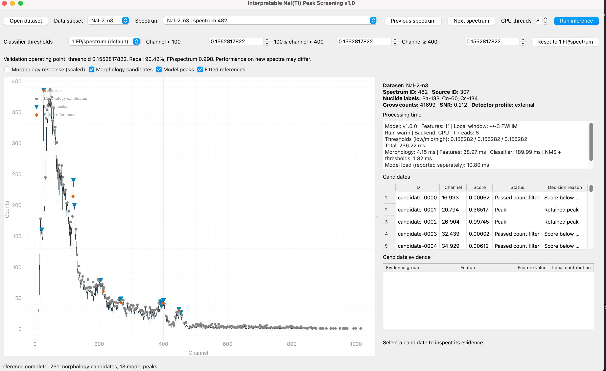

# Interpretable NaI(Tl) peak screening

This repository provides the inference implementation and graphical interface
for *Interpretable local-shape screening for morphology-based peak detection in
NaI(Tl) gamma-ray spectra*.


Repository: <https://github.com/zhangcaocao/NaI-Tl-peak-screening>

## Installation

Python 3.10 or newer is recommended.

```bash
python -m pip install -r requirements.txt
python run_gui.py
```

## Graphical interface

The GUI opens the bundled 500-spectrum demonstration set by default.
It displays the count spectrum, morphological candidates, screened peaks,
Gaussian-fit references, nuclide labels, candidate scores, the eleven local
shape measurements, signed model contributions, and processing time.


## Python API

```python
from nai_peak import PeakScreeningModel

model = PeakScreeningModel.from_pretrained(
    "assets/model",
    backend="cpu",
    num_threads=8,
    detector_profile="external",
)
result = model.predict_spectrum(raw_counts, return_contributions=True)
print(result.to_summary())
```

The input is one finite, non-negative, 1024-channel count spectrum.
`result.morphology_candidates` contains the permissive candidate set,
`result.scored_candidates` contains candidates that pass the count filter, and
`result.peaks` contains the final screened peak list.

## Interpretable evidence

| Group | Measurements | Spectral interpretation |
|---|---|---|
| G1 Morphological salience | `morph_height`, `morph_prominence` | Candidate prominence in the white top-hat response |
| G2 Local response concentration | `core_concentration`, `inner_outer_ratio` | Concentration of positive excess near the candidate centre |
| G3 Centering and symmetry | `left_right_symmetry`, `excess_centroid_offset` | Balance and centring of the local response |
| G4 Local convexity and texture | `normalized_curvature`, `edge_core_contrast`, `local_roughness_ratio` | Convexity, core contrast, and side-region texture |
| G5 Neighbour competition | `nearest_max_distance_fwhm`, `competitor_height_ratio` | Separation from and strength relative to nearby maxima |

For every scored candidate, the GUI reports the measurement value and its
signed contribution to the model margin.

## Demonstration data

`assets/examples/nai_demo_500.pkl` contains 500 example spectra with 1024
channels. `nai_demo_annotations.json` contains the corresponding fitted
reference peaks, and `sample_manifest.csv` records source IDs and count-array
hashes.

To use another data format, adapt `nai_peak/data.py` to produce the fields in
`SpectrumRecord`. The count array and detector profile are consumed by the
inference path; the remaining fields support display in the GUI.

Python pickle files may execute code when loaded. Open trusted files and verify
the checksums in `SHA256SUMS`.

## Licence and citation

The source code is available under the Apache License 2.0 in `LICENSE`. The
model weights and demonstration data are available under CC BY 4.0 in
`LICENSE-ASSETS.txt`; attribution guidance is provided in
`ASSET_ATTRIBUTION.md`. Citation metadata are provided in `CITATION.cff`.
